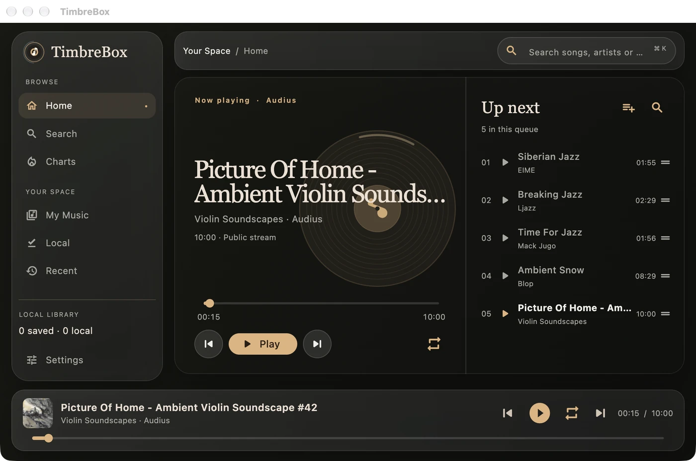
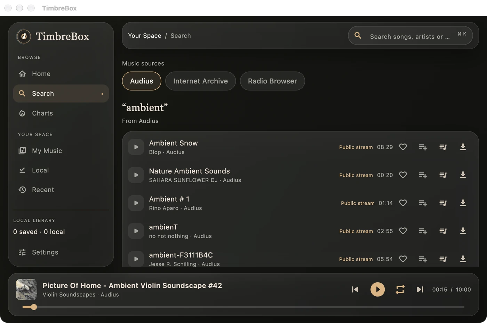
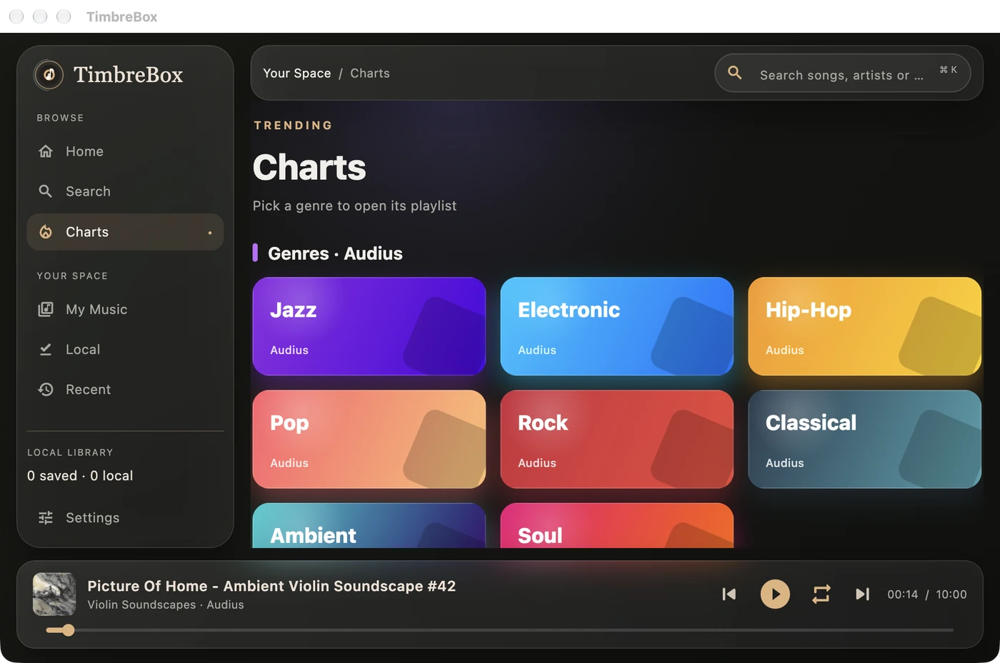
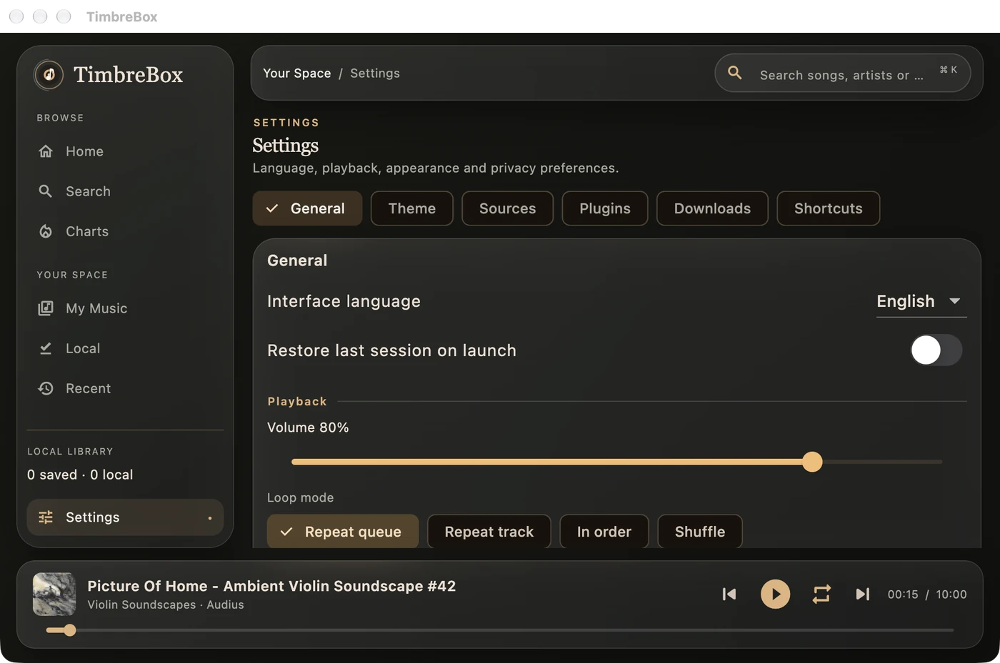
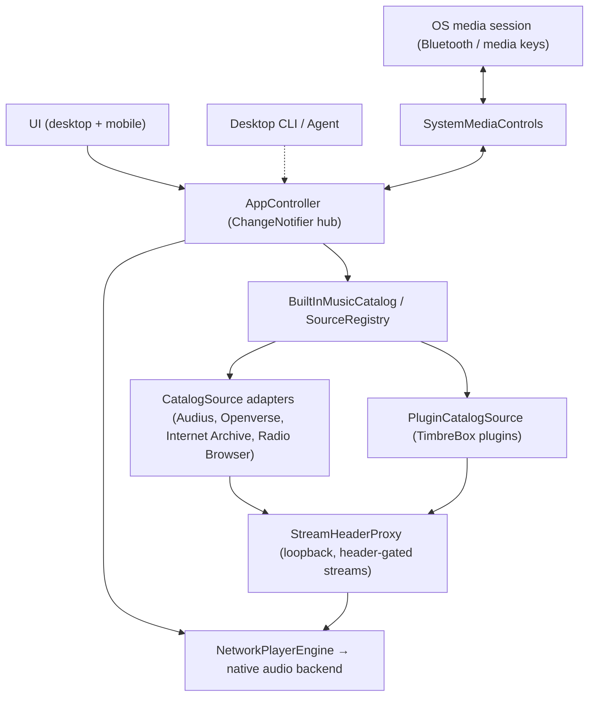

<div align="center">

# TimbreBox

**A free, open, simple and lightweight music player for Windows, macOS, Linux, iOS and Android.**

<p>
  
  <a href="./LICENSE"></a>
  
</p>

[English](README.md) · [简体中文](README.zh-CN.md)



</div>

---

TimbreBox is a music player that stays out of your way:

- **Free.** No price, no subscription, no ads, no account to create.
- **Open.** Every line of its source code is public: read it, build it and change it for any noncommercial use ([PolyForm Noncommercial](./LICENSE)).
- **Simple.** Search, play, queue, lyrics. One window, one clear state for loading, errors and empty results; never fake data.
- **Lightweight.** The audio engine starts on the first track, not at launch, and releases its resources after a pause.
- **Private.** Local first: your library, favorites and settings stay on your device, and TimbreBox sends no analytics or tracking.
- **Everywhere.** Windows, macOS, Linux, iOS and Android from one shared codebase.

It searches and plays open music sources with public APIs (Audius, Openverse, Internet Archive, Radio Browser), and you can add more sources yourself with plugins (see [Sources and plugins](#sources-and-plugins)).

> **Language note.** The in-app UI is bilingual (中文 / English). Every doc ships an English file plus a `*.zh-CN.md` Simplified-Chinese sibling — this README ([README.zh-CN.md](README.zh-CN.md)), [`AGENTS.md`](./AGENTS.md), and the guides under [`docs/`](./docs).

## Table of Contents

- [Screenshots](#screenshots)
- [Features](#features)
- [Architecture](#architecture)
- [Install](#install)
- [Getting Started](#getting-started)
- [Project Structure](#project-structure)
- [Plugin System](#plugin-system)
- [Configuration & Permissions](#configuration--permissions)
- [Documentation](#documentation)
- [Development](#development)
- [Roadmap](#roadmap)
- [Contributing](#contributing)
- [Security policy](#security-policy)
- [License](#license)

## Screenshots

Taken from the macOS app with real results from the open sources (Audius, Internet Archive, Radio Browser); the UI
also comes in Chinese ([简体中文 README](README.zh-CN.md#截图)).

<table>
  <tr>
    <td width="50%"></td>
    <td width="50%"></td>
  </tr>
  <tr>
    <td align="center"><b>Home</b> — now playing, seekable progress and the play queue</td>
    <td align="center"><b>Search</b> — one query across sources, with favorite, queue and download on every row</td>
  </tr>
  <tr>
    <td></td>
    <td></td>
  </tr>
  <tr>
    <td align="center"><b>Charts</b> — genre playlists backed by real trending data</td>
    <td align="center"><b>Settings</b> — language, playback, theme, sources, plugins, downloads, shortcuts</td>
  </tr>
</table>

## Features

### Playback engine
- Single native player instance powered by the built-in audio engine.
- Play / pause / stop, previous / next, seek, volume, single-track and list repeat.
- Playback queue: add, insert-next, remove, reorder, clear; queue and playback position are restored after restart.
- Resource release shortly after pause/stop (configurable), keeping idle footprint low.

### Music sources
A uniform `MusicSource` / `CatalogSource` contract normalizes every source into the same `CatalogTrack` model. Built-in sources registered by `BuiltInMusicCatalog.standard()`:

| Source | ID | Notes |
| --- | --- | --- |
| Audius | `audius` | Open music network; also powers real trending in the hot library. |
| Openverse | `openverse` | Openly licensed music from Jamendo, Freesound, Wikimedia Commons and ccMixter; each track shows its licence (for example CC BY 4.0). No account; anonymous use allows 20 results a page, 12 pages deep and about 200 requests a day. |
| Internet Archive | `internet_archive` | Public audio search (`mediatype:audio`), resolved at play time. |
| Radio Browser | `radio_browser` | Global live-radio directory (discovery only, not part of song fan-out search); also powers Chinese radio in the hot library. |

Video and streaming platforms (YouTube, Bilibili, Douyin, TikTok and others) are not built in. Tracks you saved from them before stay in your library and explain, when played, that a plugin can add their source back.

### Search (infinite scroll)
- Single-source and "all sources" search from one `MusicCatalog`.
- All-sources fan-out runs with **bounded concurrency (max two sources at a time)**, the rest queued, with progressive results.
- Per-source failures are surfaced individually instead of collapsing into a global blank.
- Waterfall / infinite-scroll pagination threaded through each source, de-duplicated by reference, with an honest "reached end" marker.

### Hot library (discovery)
- Genre / trending playlists backed by real source data (Audius trending, by genre).
- Chinese radio: the most voted working stations of mainland China, Taiwan and Hong Kong, and worldwide (Radio Browser).
- Static, versioned chart definitions as a graceful fallback when dynamic charts are unavailable.
- Plugin-provided charts via `getTopLists` / `getTopListDetail` surfaced as `PluginTopListItem`.

### Local downloads
- Download with progress, best-available single-file audio; playback prefers the local file afterward.
- Persisted through a `library-index.json` in the download folder that stores **only file names inside that folder** — never source URLs, headers, or tokens; entries pointing anywhere else are ignored.
- Restart plays the downloaded file without touching the original source.

### Appearance: themes, custom skin, liquid glass
- **Four selectable themes**: Light (浅色), Dark (深色, default), System (跟随系统), and Black (纯黑 / AMOLED).
- **Custom skin**: a user-supplied background image; when set, a legible dark palette is forced over the image scrim.
- **Liquid-glass UI** (`GlassPanel`): backdrop blur, translucent gradient surfaces, a single warm gold accent (`#E1B27B`), hairline borders. A global **reduced-effects** toggle drops blur/shadow for performance and accessibility.

### Bluetooth & media-key control
- No custom Bluetooth stack — the OS decodes AVRCP from Bluetooth headsets and delivers transport events to the app that owns the media session.
- A single `SystemMediaControls` abstraction pushes now-playing metadata + playback state to the OS and receives play / pause / next / previous / stop / seek back into the audio engine.
- Backed by system media-session integration on Apple platforms and Android; the built-in audio engine remains the *only* audio engine (the session layer is bridge-only and never plays audio itself).
- **Route-aware:** when the Bluetooth/headphone output **disconnects**, playback pauses and remembers the position; when it **reconnects**, it resumes — so audio never suddenly blasts out of the speakers. (macOS via CoreAudio, Windows/Linux via the player's device list, iOS/Android via the audio session.)

### Keyboard shortcuts (desktop)
- On Windows / macOS / Linux the player answers modifier combinations built on the platform accelerator (**⌘** on macOS, **Ctrl** on Windows/Linux), rendered per platform convention: **⌘/Ctrl + P** play/pause, **⌘/Ctrl + ← / →** seek ∓5s, **⌘/Ctrl + ↑ / ↓** volume ∓5%, **⌘/Ctrl + ⇧ + ← / →** previous/next. Typing in the search box is never intercepted.
- Every binding is shown and **rebindable in Settings → Shortcuts** (click a key, press the combo you want), with one-click reset to defaults; choices persist across restarts.

### Lyrics
- In-app, line-synced lyrics with tap-to-seek and clear status when lyrics are missing or out of sync — never blocking playback. Plugin-provided lyrics are supported via `getLyric`.

### Plugin system
- Third-party sources in the TimbreBox plugin format: paste a plugin URL and it becomes a new searchable, playable source. See [Plugin System](#plugin-system).

### Agent control (Claude Code / Codex CLI)
- The app runs a **local loopback control API** (on by default; bound to `127.0.0.1`, requests from web pages are refused, and every request carries a per-run token from a file only your account can read), so a local AI agent can search and play by natural language. Say "play some Jay Chou" / "播放周杰伦的歌" and the agent searches, picks the best match, and plays it — then pause / resume / skip / seek / set volume / change loop or shuffle mode / manage the queue / enable-disable a source.
- **Claude Code** auto-invokes the bundled `timbrebox-control` skill; **Codex CLI** and any local script drive the same API through `tools/timbrebox-ctl` or plain `curl` (with the `X-TimbreBox-Token` header) on `127.0.0.1`.
- Runs in the **background** on every desktop — close the window and the app keeps serving the API (reopen by relaunching; `timbrebox-ctl quit` to exit). Nothing off the machine can reach it. See [Agent control API](./docs/agent-control-api.md).

## Architecture

TimbreBox is a monorepo split into a platform shell and a pure-Dart domain core, so UI, playback, and source HTTP stay decoupled — a new source only implements a small adapter.

```
apps/timbrebox_app           Five-platform shell (UI, state, plugins)
packages/timbrebox_core      Pure-Dart domain core (media refs, source registry, player controller, queue)
packages/timbrebox_sources   Online sources, header proxy, egress policy, LRC lyrics (pure Dart, shared)
packages/timbrebox_playback  media_kit playback backend (Flutter, shared)
packages/timbrebox_cli    Player-free one-shot CLI client (Agent surface, in progress)
```

Layered flow:



Key pieces:

- **`AppController`** (`ChangeNotifier`) is the single state hub — playback, search, favorites, downloads, hot library, plugins, appearance, settings, session restore, and the media-session bridge. The UI observes it through `AnimatedBuilder`; there is no external state-management package.
- **Source abstraction** — `CatalogSource` (implements `MusicSource` + `StreamResolver`) is the app-facing adapter contract. The core **`SourceRegistry`** indexes sources by unique ID, tracks enabled/disabled sets, and runs bounded-concurrency `searchAll` / `searchBatch`.
- **`StreamHeaderProxy`** is a pure-Dart loopback `HttpServer` on `127.0.0.1` that makes header-gated / range-limited remote audio playable by the audio engine. It injects Referer / Cookie / User-Agent per hop and, in chunked mode, stitches bounded (≤ 1 MB) range windows into one continuous response — required because googlevideo rejects open or large ranges with 403. Everything lives in memory and is torn down on stop.
- **System media session** — `createSystemMediaControls()` returns a media-session-backed implementation on iOS / macOS / Android and a `NoopMediaControls` elsewhere; a handler translates transport buttons (including Bluetooth AVRCP) into `MediaCommand`s.

## Install

Release packages are published on the [Releases page](https://github.com/weikxs/timbrebox/releases), built by
GitHub Actions from this repository. No release has been published so far; until then, build TimbreBox from source
as in [Getting Started](#getting-started).

### macOS and Linux, fully automatic

```sh
curl -fsSL https://raw.githubusercontent.com/weikxs/timbrebox/main/install.sh | sh
```

The script picks the package for your system, checks it against the release's `checksums.txt` and installs it —
nothing else is changed:

| System | What it installs |
|---|---|
| macOS | `TimbreBox.app` into `/Applications` (or `~/Applications`), without the "downloaded from the internet" prompt |
| Debian, Ubuntu (x86_64) | the `.deb`, with `apt` (asks for `sudo`) |
| Any other Linux (x86_64) | the `.tar.gz`, into `~/.local/share/timbrebox`, as `timbrebox-app` in `~/.local/bin`, with an applications-menu entry; GTK 3 and libmpv come from your distribution |

Run it again to upgrade. Options go after `sh -s --`, for example `sh -s -- --version v0.1.0`:

| Option | Meaning |
|---|---|
| `--version <tag>` | install this release instead of the latest |
| `--format deb\|tar` | Linux: choose the package format |
| `--dir <folder>` | macOS: where `TimbreBox.app` goes; `.tar.gz`: where `timbrebox-app` goes |
| `--no-modify-path` | `.tar.gz`: do not add the folder to your shell's `PATH` |

### Homebrew (macOS)

```sh
brew install --cask weikxs/tap/timbrebox
brew upgrade --cask timbrebox          # later, to upgrade
```

### Packages

Download from the [latest release](https://github.com/weikxs/timbrebox/releases/latest) and check the file against
`checksums.txt` (`shasum -a 256 -c checksums.txt --ignore-missing`):

| File | Platform |
|---|---|
| `timbrebox_<version>_darwin_universal.dmg` | macOS 10.15+, Apple silicon and Intel |
| `timbrebox_<version>_linux_amd64.deb` | Debian 12+, Ubuntu 22.04+ and their relatives (x86_64) |
| `timbrebox_<version>_linux_amd64.tar.gz` | Other Linux distributions with glibc, GTK 3 and libmpv (x86_64) |
| `timbrebox_<version>_windows_amd64.zip` | Windows 10 and 11 (x64): unzip and start `timbrebox_app.exe` |

Android and iOS are not released as packages; build them from source.

The macOS app is not signed or notarized by Apple, and we do not plan to sign it. The script and Homebrew handle
that for you. If you install the disk image yourself, check it against `checksums.txt`, open TimbreBox once, then
choose **Open Anyway** in System Settings → Privacy & Security and open it again — or run
`xattr -dr com.apple.quarantine /Applications/TimbreBox.app`. The Windows app is not signed either: if SmartScreen
stops it, choose **More info** → **Run anyway**. Details in [SECURITY.md](SECURITY.md#release-packages-and-macos).

### Uninstall

| Installed with | Remove with |
|---|---|
| The script or the disk image (macOS) | Quit TimbreBox, then move `TimbreBox.app` to the Trash |
| Homebrew | `brew uninstall --cask timbrebox` |
| `.deb` | `sudo apt remove timbrebox` |
| `.tar.gz` (with the script) | `rm -r ~/.local/share/timbrebox ~/.local/bin/timbrebox-app ~/.local/share/applications/timbrebox.desktop ~/.local/share/icons/hicolor/512x512/apps/timbrebox.png` |
| `.zip` (Windows) | Delete the unzipped `TimbreBox` folder |

Uninstalling never touches your favorites, playlists, downloads or settings: they stay in the app's own folder.

## Getting Started

To build and run TimbreBox from source, follow these steps.

### Prerequisites
- **Flutter SDK** with Dart **`^3.12.0`** (`flutter --version`).
- Platform toolchains for your targets:
  - **macOS**: Xcode + CocoaPods.
  - **Windows**: Visual Studio with the "Desktop development with C++" workload.
  - **Linux**: standard Flutter Linux desktop dependencies plus libmpv for the audio engine (on Debian and Ubuntu: `clang cmake ninja-build pkg-config libgtk-3-dev libmpv-dev`).
  - **iOS**: Xcode + CocoaPods.
  - **Android**: Android SDK + NDK (Android Studio recommended).

### Clone & install
```bash
git clone https://github.com/weikxs/timbrebox.git
cd timbrebox/apps/timbrebox_app
flutter pub get
```

### Run
```bash
# Desktop
flutter run -d macos
flutter run -d windows
flutter run -d linux

# Mobile (device or emulator connected)
flutter run -d <device-id>
```

### Build
```bash
flutter build macos      # → build/macos/Build/Products/Release
flutter build windows
flutter build linux
flutter build apk         # Android
flutter build ios         # iOS (code signing required)
```

## Project Structure

```
timbrebox/
├── apps/
│   └── timbrebox_app/                 # Five-platform shell
│       ├── lib/
│       │   ├── main.dart              # Boot: audio engine init → runApp
│       │   └── app/
│       │       ├── timbrebox_app.dart # Root MaterialApp, theme/palette resolution
│       │       ├── shell_page.dart    # Main navigation shell
│       │       ├── views/             # home, hot, library, search
│       │       ├── widgets/           # glass_panel, mini_player, track_list, …
│       │       ├── state/             # AppController, engine, resolvers, stores
│       │       ├── plugins/           # TimbreBox plugin runtime & repo
│       │       ├── design/            # app_themes, timbre_colors, app_effects
│       │       └── model/             # Preferences and other app-only models
│       └── assets/plugin_shims/       # Bundled JS modules for the plugin sandbox
├── packages/
│   ├── timbrebox_core/                # Pure-Dart core: source registry, player, queue
│   ├── timbrebox_sources/             # Online sources, StreamHeaderProxy, egress policy, LRC
│   ├── timbrebox_playback/            # media_kit playback backend
│   └── timbrebox_cli/                 # One-shot CLI (Agent surface)
└── docs/                              # Design system, plugin & control-API guides
```

## Plugin System

TimbreBox supports third-party source plugins in the TimbreBox plugin format. A plugin is a single CommonJS `.js` file exporting metadata (`platform`, `version`, `srcUrl`, …) plus async functions — at minimum `search(query, page, type)` and `getMediaSource(item, quality)`, with optional `getLyric`, `getTopLists`, and `getTopListDetail`.

**How it works**
- Each plugin's JavaScript runs in a sandboxed JavaScript engine (a native JS runtime on each platform). The *only* capability injected into the sandbox is HTTP, through a pending-promise bridge — no filesystem, process, socket, or FFI access.
- A whitelisted `require` exposes a small set of bundled, pure-JS modules — an HTTP client shim, `crypto-js`, `cheerio`, `he`, `dayjs`, `qs`, and `big-integer`; anything else throws.
- Outbound requests are governed at the Dart layer (public hosts only, checked after DNS resolution and on every redirect hop; size / redirect / timeout caps; plugins are installed over HTTPS only). Streams that need custom headers are routed through `StreamHeaderProxy` so the audio engine can play them.

**Installing a plugin**
- In the app, paste a raw `.js` plugin URL (or a subscription JSON `{ desc, plugins: [...] }`). A repository `blob` URL is automatically rewritten to its raw form.
- On install, the plugin is fetched once, validated (must declare a non-empty `platform` and a `search` function), fingerprinted with SHA-256, and stored under `<app-support>/plugins/<id>/` as `plugin.js` + `manifest.json`.
- Plugins can be enabled/disabled per source and updated (re-installed only when the SHA changes).

Plugin authoring and the full sandbox/security model are documented in [`docs/plugin-development.md`](./docs/plugin-development.md).

> Security: on every platform a plugin runs in its own sandboxed engine with HTTP as its only capability, a time limit on each run (not yet on Windows), and an explicit consent step before install.

## Configuration & Permissions

### macOS entitlements (`macos/Runner/*.entitlements`)
- `com.apple.security.app-sandbox` — sandboxed.
- `com.apple.security.network.client` — outbound network for sources.
- `com.apple.security.network.server` — **required** for the loopback `StreamHeaderProxy`.
- `com.apple.security.files.downloads.read-write` — local downloads.
- `com.apple.security.cs.allow-jit` — debug builds only, for the JS engine.

### Android (`android/app/src/main/AndroidManifest.xml`)
- Permissions: `INTERNET`, `WAKE_LOCK`, `FOREGROUND_SERVICE`, `FOREGROUND_SERVICE_MEDIA_PLAYBACK`.
- Media session integration: an audio service with `foregroundServiceType="mediaPlayback"`, a media-browser intent filter, and a media-button receiver for hardware media keys (channel `com.timbrebox.audio`).

### iOS (`ios/Runner/Info.plist`)
- `UIBackgroundModes = [audio]` for background audio playback.

## Documentation

- [Design system](./docs/DESIGN.md) — palette, typography, layout, and motion rules.
- [Plugin development](./docs/plugin-development.md) — write, package, install, and debug a source plugin.
- [Agent control API](./docs/agent-control-api.md) — the local loopback HTTP interface that lets an agent search, play, and control playback.
- [Agent collaboration rules](./AGENTS.md) — scope, workflow, and hard boundaries for contributors and agents.

Every guide has a `*.zh-CN.md` Simplified-Chinese sibling.

## Development

### Coding standards
See [`AGENTS.md`](./AGENTS.md) and [`docs/DESIGN.md`](./docs/DESIGN.md). Core rules:
- **Immutable data** — UI renders immutable state; `PlaybackState` is projected immutably.
- **Small, cohesive files** — a single file stays **≤ 800 lines**; split as it grows.
- **DRY / KISS / YAGNI** — reuse before writing new code (Rule of Three); no dead, placeholder, mock, or hardcoded data — every value comes from a real source with honest loading/error/empty states.
- **Hard boundaries** — no collecting source accounts, cookies, API keys, or device IDs; no built-in source that works around a platform's restrictions; no DRM bypass; plugins run only inside the sandbox.
- **Test target** — 80%+ coverage goal; parsing is tested against recorded fixtures; network integration tests are separately tagged.

### Commands

From the repository root (`make help` lists every target):

```bash
make check      # everything CI runs: privacy, analysis, formatting and tests of every package
make test       # the tests of the core, CLI and app packages
make fmt        # format the Dart code
make hooks      # use the repository's git hooks (privacy check, Conventional Commits)
make app        # release build of the desktop app for this machine
make package    # the same build, packaged as a release packages it, into dist/
```

`make check` runs [`tools/check.sh`](tools/check.sh), which CI's `check` job runs in the Flutter 3.44 container.
See [CONTRIBUTING.md](CONTRIBUTING.md) and the [development standards](docs/development/standards.md).

Current status: app, core and CLI tests passing, static analysis clean, macOS release build clean.

## Roadmap

Legend: ✅ done · 🚧 in progress · 📋 planned

**Playback & sources**
- ✅ Native-engine playback, queue, seekable progress (hero + mini players)
- ✅ Unified catalog + seven built-in source adapters normalized to `CatalogTrack`
- ✅ Bounded-concurrency search with per-source failure surfacing
- ✅ Waterfall pagination (real paging for Internet Archive and Radio Browser)
- 🚧 Per-source five-platform / credential-free release acceptance; page-2+ for video sources

**Downloads & library**
- ✅ Local download + persisted `library-index.json`; restart plays local file
- ✅ Favorites, playlists, the play queue and the playback position persist across restarts

**Plugin system**
- ✅ P0/P1 — sandboxed JS runtime, HTTP bridge, install from a `.js` URL, `PluginCatalogSource`, dynamic registration, persistence
- ✅ P2 — subscription JSON, plugin URL normalization, SHA-gated updates
- 📋 P3 — plugin lyrics / charts / recommendations, user-variable (cookie/token) UI
- 📋 P4 — hardening: subscription allowlist, request-audit UI, resource quotas

**Bluetooth / media session & keyboard**
- ✅ Apple (iOS + macOS) and Android via system media-session integration (media keys + Bluetooth AVRCP)
- ✅ Desktop in-app keyboard shortcuts — customizable modifier combinations (⌘/Ctrl based), platform-standard display
- 🚧 Windows (SMTC) and Linux (MPRIS) media-session backends — code complete, pending on-device verification

**Agent control & i18n**
- ✅ Local loopback control API (search / play / transport / queue / sources / lyric), on by default, per-run token in a user-only file
- ✅ `tools/timbrebox-ctl` CLI + `timbrebox-control` skill — natural-language play for Claude Code / Codex CLI
- ✅ `timbrebox` one-shot Dart CLI package (full command set, `--json`) over the control API
- ✅ MCP stdio server (`dart run timbrebox_cli:timbrebox_mcp`) bridging tools (play_music / pause / resume / next / previous / stop / set_volume / get_status) to the control API
- 📋 Full Chinese / English i18n externalization

## Contributing

Contributions are welcome. Please read [CONTRIBUTING.md](CONTRIBUTING.md) and the [code of conduct](CODE_OF_CONDUCT.md) first. Before submitting:

1. Follow the workflow in [`AGENTS.md`](./AGENTS.md): plan → review existing code → propose options → implement → verify.
2. Run `make check` — privacy, analysis, formatting and the tests of every package must pass cleanly.
3. Keep files ≤ 800 lines, prefer immutable data, and reuse existing utilities.
4. No mock/hardcoded data, no bundled third-party source code, no secrets.
5. Use [Conventional Commits](https://www.conventionalcommits.org/) (`feat:`, `fix:`, `perf:`, `refactor:`, `docs:`, `test:`, `chore:`); `make hooks` checks them.

New sources should implement the `CatalogSource` adapter contract rather than touching UI or playback code.
Notable changes are recorded in the [changelog](CHANGELOG.md).

## Sources and plugins

TimbreBox is a player. Its built-in sources are open services with public APIs only; it builds in no video or streaming platform, and it neither provides nor maintains plugins for one.

- Plugins are written and published by third parties, and you choose which to install. A plugin, and any data it produces, has nothing to do with TimbreBox. Check a plugin before you install it, and use it within the law and the rules of the services it reaches.
- TimbreBox does not encourage, and will not build in, anything that works around a platform's restrictions or unlocks paid content. Your own music library is always the safest source.

## Security policy

Please report vulnerabilities privately as described in [SECURITY.md](SECURITY.md), not in public issues.

## License

Licensed under the **PolyForm Noncommercial License 1.0.0** — see [`LICENSE`](./LICENSE). The software is provided for noncommercial research, study, testing, and personal use; **commercial use requires a separate written license** from the copyright holder. Copyright © 2026 TimbreBox contributors.
