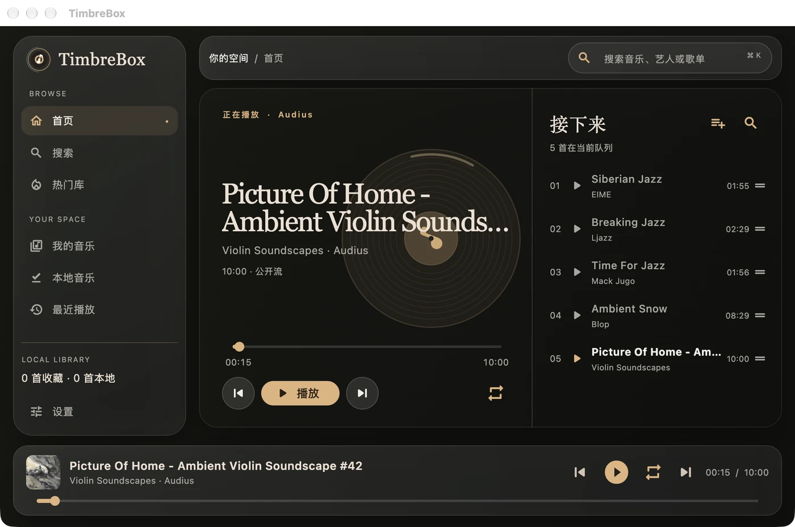
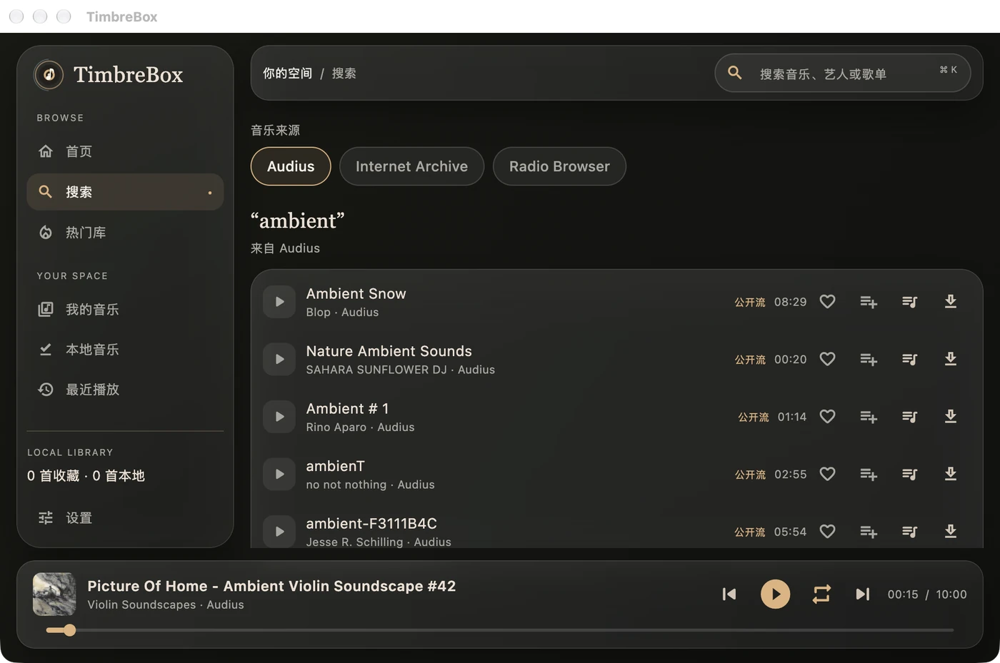
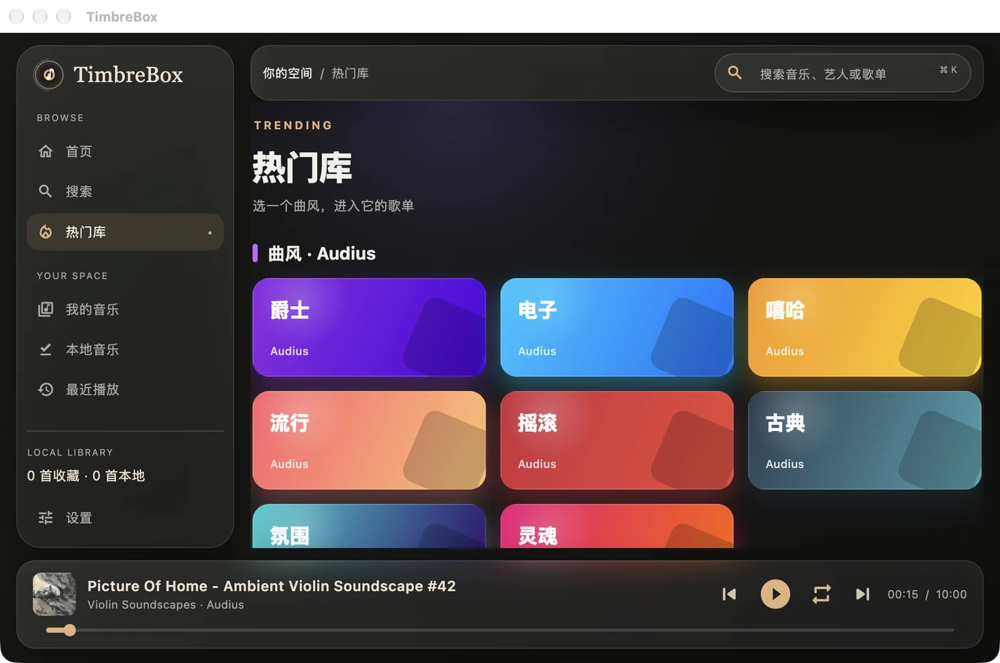
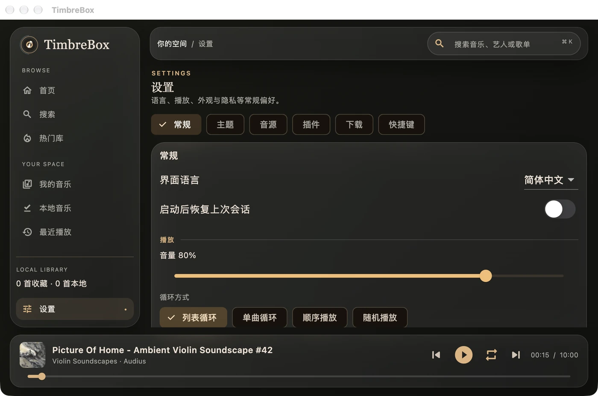
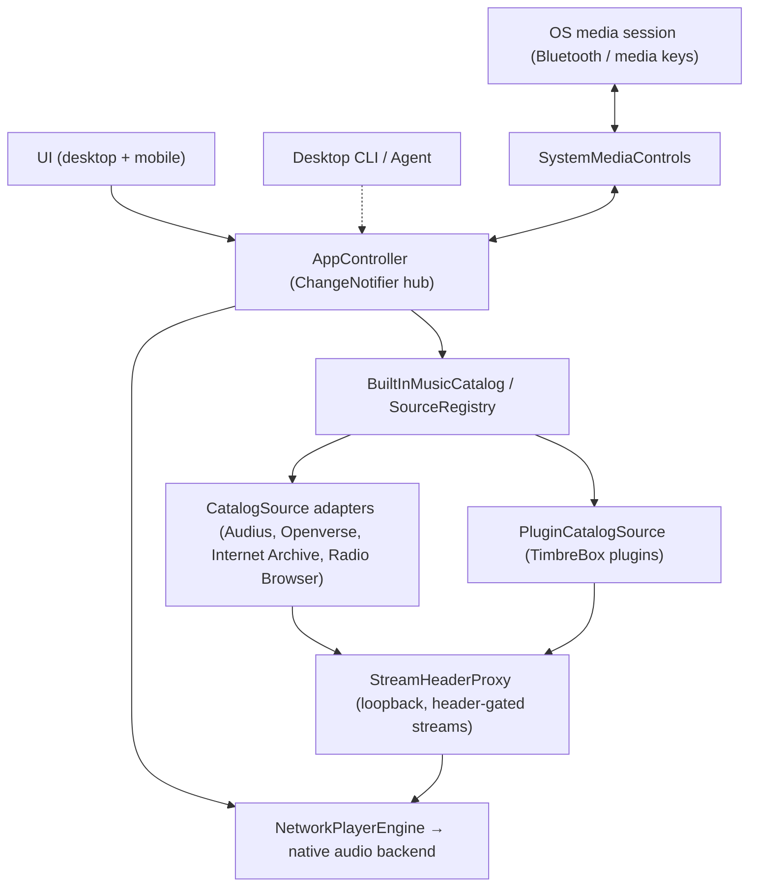

<div align="center">

# TimbreBox · 音色盒

**免费、开源、简洁、轻便的音乐播放器，支持 Windows、macOS、Linux、iOS 和 Android。**

<p>
  
  <a href="./LICENSE"></a>
  
</p>

[English](README.md) · [简体中文](README.zh-CN.md)



</div>

---

TimbreBox（音色盒）是一个不打扰你的音乐播放器：

- **免费。** 不收费、不订阅、没有广告，也不用注册账号。
- **开源。** 全部源代码公开：可以阅读、自己构建、修改，用于任何非商业用途（[PolyForm Noncommercial](./LICENSE) 许可证）。
- **简洁。** 搜索、播放、队列、歌词。一个窗口；加载、出错、没有结果都有清楚的状态，从不显示假数据。
- **轻便。** 音频引擎在播放第一首歌时才启动，而不是一打开就启动；暂停后会释放资源。
- **私密。** 本地优先：曲库、收藏和设置都留在你的设备上，TimbreBox 不收集任何统计或跟踪数据。
- **五端通用。** Windows、macOS、Linux、iOS 和 Android 共用同一套代码。

它可以搜索和播放有公开接口的开放音乐源（Audius、Openverse、Internet Archive、Radio Browser），你也可以通过插件自己添加更多音源（见[关于音源与插件](#关于音源与插件)）。

> **语言说明。** 应用内 UI 为双语（中文 / English）。每份文档都提供英文版加一个 `*.zh-CN.md` 简体中文对照——本 README（英文版 [README.md](README.md)）、[`AGENTS.md`](./AGENTS.zh-CN.md) 以及 [`docs/`](./docs) 下的各指南。

## 目录

- [截图](#截图)
- [功能特性](#功能特性)
- [架构](#架构)
- [安装](#安装)
- [快速开始](#快速开始)
- [项目结构](#项目结构)
- [插件系统](#插件系统)
- [配置与权限](#配置与权限)
- [文档](#文档)
- [开发](#开发)
- [路线图](#路线图)
- [贡献](#贡献)
- [安全策略](#安全策略)
- [许可证](#许可证)

## 截图

截自 macOS 版，内容是开放音源（Audius、Internet Archive、Radio Browser）返回的真实结果；界面也有英文版（见
[English README](README.md#screenshots)）。

<table>
  <tr>
    <td width="50%"></td>
    <td width="50%"></td>
  </tr>
  <tr>
    <td align="center"><b>首页</b>——正在播放、可拖动的进度条和播放队列</td>
    <td align="center"><b>搜索</b>——一次搜索覆盖多个音源，每一行都能收藏、加入队列和下载</td>
  </tr>
  <tr>
    <td></td>
    <td></td>
  </tr>
  <tr>
    <td align="center"><b>热门库</b>——由真实热门数据生成的流派歌单</td>
    <td align="center"><b>设置</b>——语言、播放、主题、音源、插件、下载、快捷键</td>
  </tr>
</table>

## 功能特性

### 播放引擎
- 由内置音频引擎驱动的单一原生播放器实例。
- 播放 / 暂停 / 停止、上一首 / 下一首、拖动定位、音量、单曲与列表循环。
- 播放队列：添加、插入到下一首、移除、重排、清空；队列与播放进度在重启后恢复。
- 暂停/停止后不久即释放资源（可配置），保持空闲占用极低。

### 音源
统一的 `MusicSource` / `CatalogSource` 契约将每个音源规范化为同一个 `CatalogTrack` 模型。由 `BuiltInMusicCatalog.standard()` 注册的内置音源：

| 音源 | ID | 说明 |
| --- | --- | --- |
| Audius | `audius` | 开放音乐网络；也为热门库提供真实的趋势数据。 |
| Openverse | `openverse` | 来自 Jamendo、Freesound、维基共享资源和 ccMixter 的开放授权音乐；每首歌都标出授权方式（例如 CC BY 4.0）。无需账户；匿名使用每页 20 条、最多 12 页、每天约 200 次请求。 |
| Internet Archive | `internet_archive` | 公开音频搜索（`mediatype:audio`），在播放时解析。 |
| Radio Browser | `radio_browser` | 全球实时电台目录（仅用于发现，不参与歌曲的多源并发搜索）；也为热门库的中文电台提供数据。 |

视频与流媒体平台（YouTube、哔哩哔哩、抖音、TikTok 等）不再内置。以前从这些平台收藏的歌仍然保留在曲库里；播放时会说明可以安装插件把对应音源加回来。

### 搜索（无限滚动）
- 基于同一个 `MusicCatalog` 的单源搜索与“全部音源”搜索。
- 全音源并发采用**有界并发（一次最多两个音源）**，其余排队，结果渐进式返回。
- 单个音源的失败会被单独呈现，而不是坍缩为一整片全局空白。
- 瀑布流 / 无限滚动分页贯穿每个音源，按引用去重，并带有诚实的“已到末尾”标记。

### 热门库（发现）
- 由真实音源数据支撑的流派 / 趋势歌单（Audius 按流派的趋势数据）。
- 中文电台：中国大陆、台湾、香港以及全球得票最多、当前可用的电台（Radio Browser）。
- 当动态榜单不可用时，以静态、带版本的榜单定义作为优雅降级。
- 插件提供的榜单通过 `getTopLists` / `getTopListDetail` 以 `PluginTopListItem` 呈现。

### 本地下载
- 带进度的下载，取当前可得的最佳单文件音频；下载后播放优先使用本地文件。
- 通过下载目录里的 `library-index.json` 持久化，**只存储该目录内的文件名**——绝不存储音源 URL、请求头或令牌；指向其他位置的记录会被忽略。
- 重启后直接播放已下载文件，完全不触碰原始音源。

### 外观：主题、自定义皮肤、液态玻璃
- **四种可选主题**：浅色（Light）、深色（Dark，默认）、跟随系统（System）、纯黑（Black / AMOLED）。
- **自定义皮肤**：用户提供的背景图；设置后会在图片遮罩之上强制使用一套清晰可读的深色配色。
- **液态玻璃 UI**（`GlassPanel`）：背景模糊、半透明渐变表面、单一暖金强调色（`#E1B27B`）、发丝级边框。全局的**降低特效**开关会去掉模糊/阴影，以兼顾性能与无障碍。

### 蓝牙与媒体键控制
- 没有自研蓝牙栈——由操作系统解码蓝牙耳机的 AVRCP，并把传输控制事件交付给持有媒体会话的应用。
- 单一的 `SystemMediaControls` 抽象把当前播放的元数据 + 播放状态推送给操作系统，并接收 播放 / 暂停 / 下一首 / 上一首 / 停止 / 定位 事件回传给音频引擎。
- 在苹果平台与 Android 上由系统媒体会话集成支撑；内置音频引擎始终是*唯一*的音频引擎（会话层仅作桥接，自身从不播放音频）。
- **路由感知：** 蓝牙/耳机输出**断开**时自动暂停并记住进度，**重新连接**时自动续播——避免声音突然从外放喷出。（macOS 走 CoreAudio、Windows/Linux 走播放器设备列表、iOS/Android 走音频会话。）

### 键盘快捷键（桌面）
- 在 Windows / macOS / Linux 上，播放器响应基于平台主修饰键（macOS 用 **⌘**、Windows/Linux 用 **Ctrl**）的组合键，并按各平台惯例显示：**⌘/Ctrl + P** 播放/暂停、**⌘/Ctrl + ← / →** 定位 ∓5 秒、**⌘/Ctrl + ↑ / ↓** 音量 ∓5%、**⌘/Ctrl + ⇧ + ← / →** 上一首/下一首。在搜索框里打字绝不会被拦截。
- 每个绑定都可在**设置 → 快捷键**里查看并**自定义**（点按键、再按下想要的组合），支持一键恢复默认；设置在重启后保留。

### 歌词
- 应用内逐行同步歌词，支持点按定位；当歌词缺失或不同步时给出清晰状态——绝不阻塞播放。插件提供的歌词通过 `getLyric` 支持。

### 插件系统
- 采用 TimbreBox 插件格式的第三方音源：粘贴一个插件链接，插件即成为可搜索、可播放的新音源。参见[插件系统](#插件系统)。

### Agent 控制（Claude Code / Codex CLI）
- 应用运行一个**本地回环控制 API**（默认开启；只绑定 `127.0.0.1`，拒绝网页发来的请求，每个请求都要带上本次运行的令牌，令牌存放在只有你的账户能读取的文件里），本地 AI agent 可用自然语言搜索并播放。说一句"播放周杰伦的歌" / "play some Jay Chou"，agent 就会搜索、挑最佳匹配并播放——随后可暂停 / 继续 / 切歌 / 定位 / 调音量 / 切换循环或随机 / 管理队列 / 启停音源。
- **Claude Code** 自动调用内置的 `timbrebox-control` skill；**Codex CLI** 及任意本地脚本通过 `tools/timbrebox-ctl` 或直接 `curl`（带上 `X-TimbreBox-Token` 头）访问 `127.0.0.1` 上的同一 API。
- 各桌面端均支持**后台运行** —— 关闭窗口后 app 仍持续提供 API（重新启动即可恢复窗口；`timbrebox-ctl quit` 退出）。机器之外无法访问。详见 [Agent 控制 API](./docs/agent-control-api.zh-CN.md)。

## 架构

TimbreBox 是一个 monorepo，拆分为平台外壳与纯 Dart 领域核心，使 UI、播放与音源 HTTP 保持解耦——新增一个音源只需实现一个小小的适配器。

```
apps/timbrebox_app           五端外壳（UI、状态、插件）
packages/timbrebox_core      纯 Dart 领域核心（媒体引用、音源注册表、播放控制器、队列）
packages/timbrebox_sources   在线音源、请求头代理、出网策略、LRC 歌词（纯 Dart，可共享）
packages/timbrebox_playback  media_kit 播放后端（Flutter，可共享）
packages/timbrebox_cli    无播放器的一次性 CLI 客户端（Agent 界面，开发中）
```

分层数据流：



关键组成：

- **`AppController`**（`ChangeNotifier`）是唯一的状态枢纽——播放、搜索、收藏、下载、热门库、插件、外观、设置、会话恢复以及媒体会话桥接。UI 通过 `AnimatedBuilder` 观察它；没有引入任何外部状态管理包。
- **音源抽象**——`CatalogSource`（实现 `MusicSource` + `StreamResolver`）是面向应用的适配器契约。核心中的 **`SourceRegistry`** 按唯一 ID 索引音源，跟踪启用/禁用集合，并运行有界并发的 `searchAll` / `searchBatch`。
- **`StreamHeaderProxy`** 是运行在 `127.0.0.1` 上的纯 Dart 回环 `HttpServer`，让带请求头校验 / 范围受限的远程音频能被音频引擎播放。它按每一跳注入 Referer / Cookie / User-Agent，并在分块模式下把有界（≤ 1 MB）的 range 窗口拼接成一条连续响应——这是必需的，因为 googlevideo 会用 403 拒绝开放或过大的 range 请求。所有内容都驻留在内存中，停止时即销毁。
- **系统媒体会话**——`createSystemMediaControls()` 在 iOS / macOS / Android 上返回基于系统媒体会话集成的实现，其他平台返回 `NoopMediaControls`；一个处理器把传输控制按钮（包括蓝牙 AVRCP）翻译为 `MediaCommand`。

## 安装

发布包由 GitHub Actions 从本仓库源码构建，发布在 [Releases 页面](https://github.com/weikxs/timbrebox/releases)。
目前还没有发布过任何版本；在此之前，请按[快速开始](#快速开始)从源码构建。

### macOS 与 Linux，全自动安装

```sh
curl -fsSL https://raw.githubusercontent.com/weikxs/timbrebox/main/install.sh | sh
```

脚本会为你的系统挑选安装包，用该版本的 `checksums.txt` 校验后再安装——不会改动其他任何东西：

| 系统 | 安装内容 |
|---|---|
| macOS | 把 `TimbreBox.app` 装到 `/Applications`（或 `~/Applications`），不会弹出“从互联网下载”的提示 |
| Debian、Ubuntu（x86_64） | 用 `apt` 安装 `.deb`（会请求 `sudo`） |
| 其他 Linux（x86_64） | 把 `.tar.gz` 解压到 `~/.local/share/timbrebox`，在 `~/.local/bin` 中放置 `timbrebox-app`，并添加应用菜单项；GTK 3 与 libmpv 由发行版提供 |

再次运行即可升级。参数写在 `sh -s --` 之后，例如 `sh -s -- --version v0.1.0`：

| 参数 | 含义 |
|---|---|
| `--version <tag>` | 安装指定版本，而不是最新版本 |
| `--format deb\|tar` | Linux：选择安装包格式 |
| `--dir <folder>` | macOS：`TimbreBox.app` 的安装位置；`.tar.gz`：`timbrebox-app` 的位置 |
| `--no-modify-path` | `.tar.gz`：不把该目录加入 shell 的 `PATH` |

### Windows，全自动安装

在 PowerShell 中运行：

```powershell
irm https://raw.githubusercontent.com/weikxs/timbrebox/main/install.ps1 | iex
```

脚本会下载 Windows 安装包，用发布中的 `checksums.txt` 校验，把 TimbreBox 放进
`%LOCALAPPDATA%\Programs\TimbreBox`，并添加到开始菜单。不需要管理员权限，不改动其他任何东西；Arm 版
Windows 11 通过系统自带的 x64 模拟运行。再运行一次即可升级。带选项运行，比如安装指定版本：

```powershell
& ([scriptblock]::Create((irm https://raw.githubusercontent.com/weikxs/timbrebox/main/install.ps1))) -Version v0.1.0
```

| 选项 | 含义 |
|---|---|
| `-Version <tag>` | 安装这个版本，而不是最新版 |
| `-Dir <文件夹>` | TimbreBox 的安装位置 |
| `-NoShortcut` | 不添加到开始菜单 |
| `-Uninstall` | 卸载 TimbreBox 并移除开始菜单项 |

### Homebrew（macOS）

```sh
brew install --cask weikxs/tap/timbrebox
brew upgrade --cask timbrebox          # 之后升级
```

### 安装包

从[最新版本](https://github.com/weikxs/timbrebox/releases/latest)下载，并用 `checksums.txt` 校验
（`shasum -a 256 -c checksums.txt --ignore-missing`）：

| 文件 | 平台 |
|---|---|
| `timbrebox_<version>_darwin_universal.dmg` | macOS 10.15+，Apple 芯片与 Intel |
| `timbrebox_<version>_linux_amd64.deb` | Debian 12+、Ubuntu 22.04+ 及其衍生版（x86_64） |
| `timbrebox_<version>_linux_amd64.tar.gz` | 其他带 glibc、GTK 3 与 libmpv 的 Linux 发行版（x86_64） |
| `timbrebox_<version>_windows_amd64.zip` | Windows 10 与 11（x64）：解压后运行 `timbrebox_app.exe` |

Android 与 iOS 不提供发布包，请从源码构建。

macOS 应用没有经过 Apple 签名或公证，也不打算签名。安装脚本和 Homebrew 会替你处理这一点。如果自己安装磁盘映像，
请先用 `checksums.txt` 校验，打开一次 TimbreBox，然后在“系统设置 → 隐私与安全性”中选择**仍要打开**，再次打开——
或者运行 `xattr -dr com.apple.quarantine /Applications/TimbreBox.app`。Windows 应用同样没有签名：如果 SmartScreen
拦截，请选择**更多信息** → **仍要运行**。详见 [SECURITY.md](SECURITY.md#release-packages-and-macos)。

### 卸载

| 安装方式 | 卸载方式 |
|---|---|
| 安装脚本或磁盘映像（macOS） | 退出 TimbreBox，然后把 `TimbreBox.app` 移到废纸篓 |
| Homebrew | `brew uninstall --cask timbrebox` |
| `.deb` | `sudo apt remove timbrebox` |
| `.tar.gz`（用安装脚本安装） | `rm -r ~/.local/share/timbrebox ~/.local/bin/timbrebox-app ~/.local/share/applications/timbrebox.desktop ~/.local/share/icons/hicolor/512x512/apps/timbrebox.png` |
| 安装脚本（Windows） | 退出 TimbreBox，然后带 `-Uninstall` 运行脚本：`& ([scriptblock]::Create((irm https://raw.githubusercontent.com/weikxs/timbrebox/main/install.ps1))) -Uninstall` |
| `.zip`（Windows） | 删除解压出的 `TimbreBox` 文件夹 |

卸载不会动你的收藏、歌单、下载和设置：它们保存在应用自己的目录里。

## 快速开始

按下面的步骤从源码构建并运行 TimbreBox。

### 先决条件
- **Flutter SDK**，Dart **`^3.12.0`**（`flutter --version`）。
- 面向目标平台的工具链：
  - **macOS**：Xcode + CocoaPods。
  - **Windows**：带“使用 C++ 的桌面开发”工作负载的 Visual Studio。
  - **Linux**：标准的 Flutter Linux 桌面依赖，外加音频引擎所需的 libmpv（Debian 与 Ubuntu 上为 `clang cmake ninja-build pkg-config libgtk-3-dev libmpv-dev`）。
  - **iOS**：Xcode + CocoaPods。
  - **Android**：Android SDK + NDK（推荐使用 Android Studio）。

### 克隆与安装
```bash
git clone https://github.com/weikxs/timbrebox.git
cd timbrebox/apps/timbrebox_app
flutter pub get
```

### 运行
```bash
# 桌面
flutter run -d macos
flutter run -d windows
flutter run -d linux

# 移动端（已连接设备或模拟器）
flutter run -d <device-id>
```

### 构建
```bash
flutter build macos      # → build/macos/Build/Products/Release
flutter build windows
flutter build linux
flutter build apk         # Android
flutter build ios         # iOS（需要代码签名）
```

## 项目结构

```
timbrebox/
├── apps/
│   └── timbrebox_app/                 # 五端外壳
│       ├── lib/
│       │   ├── main.dart              # 启动：音频引擎初始化 → runApp
│       │   └── app/
│       │       ├── timbrebox_app.dart # 根 MaterialApp，主题/配色解析
│       │       ├── shell_page.dart    # 主导航外壳
│       │       ├── views/             # home、hot、library、search
│       │       ├── widgets/           # glass_panel、mini_player、track_list、…
│       │       ├── state/             # AppController、engine、resolvers、stores
│       │       ├── plugins/           # TimbreBox 插件运行时与仓库
│       │       ├── design/            # app_themes、timbre_colors、app_effects
│       │       └── model/             # 偏好设置等只属于 App 的模型
│       └── assets/plugin_shims/       # 插件沙箱内置的 JS 模块
├── packages/
│   ├── timbrebox_core/                # 纯 Dart 核心：音源注册表、播放器、队列
│   ├── timbrebox_sources/             # 在线音源、StreamHeaderProxy、出网策略、LRC
│   ├── timbrebox_playback/            # media_kit 播放后端
│   └── timbrebox_cli/                 # 一次性 CLI（Agent 界面）
└── docs/                              # 设计系统、插件与控制 API 指南
```

## 插件系统

TimbreBox 支持采用 TimbreBox 插件格式的第三方音源插件。一个插件是单个 CommonJS `.js` 文件，导出元数据（`platform`、`version`、`srcUrl`、…）以及若干异步函数——最少需要 `search(query, page, type)` 与 `getMediaSource(item, quality)`，可选 `getLyric`、`getTopLists` 与 `getTopListDetail`。

**工作原理**
- 插件 JavaScript 在沙箱中运行，提供宿主 HTTP 桥接及可选的固定桌面媒体 RPC，不提供任意文件、进程、套接字或 FFI 权限。媒体后端默认不配置，构建时需明确指定已审查的本地工具与校验值；工具内部网络属于独立信任边界。
- 白名单式的 `require` 暴露一小组内置的纯 JS 模块——一个 HTTP 客户端垫片、`crypto-js`、`cheerio`、`he`、`dayjs`、`qs` 与 `big-integer`；其他任何模块都会抛错。
- 插件 HTTP 桥接请求在 Dart 层被统一治理（只允许公网主机，DNS 解析后及每一跳重定向都会检查；大小 / 重定向 / 超时上限；插件只能通过 HTTPS 安装）。需要自定义请求头的流会经由 `StreamHeaderProxy` 路由，从而让音频引擎能够播放。

**安装插件**
- 在应用内粘贴一个原始 `.js` 插件链接（或一个订阅 JSON `{ desc, plugins: [...] }`）。仓库的 `blob` 形式链接会被自动改写为其原始（raw）形式。
- 安装时，插件会被拉取一次、校验（必须声明非空的 `platform` 与一个 `search` 函数）、用 SHA-256 计算指纹，并以 `plugin.js` + `manifest.json` 的形式存储到 `<app-support>/plugins/<id>/`。
- 插件可按音源启用/禁用，并可更新（仅当 SHA 变化时才重新安装）。

插件编写方法以及完整的沙箱/安全模型见 [`docs/plugin-development.md`](./docs/plugin-development.md)。

> 安全：插件在沙箱引擎中使用受限宿主桥接，脚本有运行时间上限（Windows 暂不支持），安装前必须明确同意。可选桌面媒体后端及限制见[说明](docs/desktop-media-backend.md)；这不代表相关集成已经达到正式发布标准。

## 配置与权限

### macOS 授权项（`macos/Runner/*.entitlements`）
- `com.apple.security.app-sandbox` — 沙箱化。
- `com.apple.security.network.client` — 面向音源的出站网络。
- `com.apple.security.network.server` — 回环 `StreamHeaderProxy` **必需**。
- `com.apple.security.files.downloads.read-write` — 本地下载。
- `com.apple.security.cs.allow-jit` — 仅 debug 构建，用于 JS 引擎。

### Android（`android/app/src/main/AndroidManifest.xml`）
- 权限：`INTERNET`、`WAKE_LOCK`、`FOREGROUND_SERVICE`、`FOREGROUND_SERVICE_MEDIA_PLAYBACK`。
- 媒体会话集成：一个带 `foregroundServiceType="mediaPlayback"` 的音频服务、一个媒体浏览器 intent-filter，以及用于硬件媒体键的媒体按钮接收器（channel `com.timbrebox.audio`）。

### iOS（`ios/Runner/Info.plist`）
- `UIBackgroundModes = [audio]`，用于后台音频播放。

## 文档

- [设计系统](./docs/DESIGN.zh-CN.md) — 配色、字体排印、布局与动效规则。
- [插件开发](./docs/plugin-development.zh-CN.md) — 编写、打包、安装与调试音源插件。
- [Agent 控制 API](./docs/agent-control-api.zh-CN.md) — 本地回环 HTTP 接口，让 agent 搜索、播放并控制播放。
- [Agent 协作规则](./AGENTS.zh-CN.md) — 范围、工作流与不可突破的边界。

每份指南都有对应英文原文（去掉 `.zh-CN` 后缀）。

## 开发

### 编码规范
参见 [`AGENTS.zh-CN.md`](./AGENTS.zh-CN.md) 与 [`docs/DESIGN.zh-CN.md`](./docs/DESIGN.zh-CN.md)。核心规则：
- **不可变数据**——UI 渲染不可变状态；`PlaybackState` 以不可变方式投影。
- **小而内聚的文件**——单个文件保持在 **≤ 800 行**；随其增长即拆分。
- **DRY / KISS / YAGNI**——先复用再写新代码（三次法则）；不允许死代码、占位、mock 或硬编码数据——每个值都来自真实音源，并配有诚实的加载/错误/空状态。
- **安全边界**——不静默读取浏览器凭据，不记录秘密，不做 DRM 绕过或未授权付费访问；用户主动填写的插件设置仅本机保存、仅交给该插件；插件在沙箱中运行。
- **测试目标**——80%+ 覆盖率目标；解析针对录制的 fixture 进行测试；网络集成测试单独打标签。

### 命令

在仓库根目录运行（`make help` 列出所有目标）：

```bash
make check      # CI 运行的全部检查：隐私、静态分析、格式和每个包的测试
make test       # 核心包、CLI 和应用的测试
make fmt        # 格式化 Dart 代码
make hooks      # 启用仓库的 git hooks（隐私检查、约定式提交）
make app        # 为本机构建桌面应用的 release 版本
make package    # 同样的构建，按发布时的方式打包到 dist/
```

`make check` 运行 [`tools/check.sh`](tools/check.sh)，CI 的 `check` 任务在 Flutter 3.44 容器中运行的也是它。
参见 [CONTRIBUTING.md](CONTRIBUTING.md) 与[开发规范](docs/development/standards.md)。

当前状态：应用、核心包和 CLI 的测试全部通过，静态分析无告警，macOS release 构建干净。

## 路线图

图例：✅ 已完成 · 🚧 进行中 · 📋 计划中

**播放与音源**
- ✅ 原生引擎播放、队列、可拖动进度（主播放器 + 迷你播放器）
- ✅ 统一目录 + 七个内置音源适配器，规范化为 `CatalogTrack`
- ✅ 有界并发搜索，并单独呈现每个音源的失败
- ✅ 瀑布流分页（Internet Archive、Radio Browser 的真实分页）
- 🚧 各音源的五端 / 免凭据发布验收；视频音源的第 2 页及以后

**下载与曲库**
- ✅ 本地下载 + 持久化的 `library-index.json`；重启后播放本地文件
- ✅ 收藏、歌单、播放队列与播放进度在重启后保留

**插件系统**
- ✅ P0/P1 — 沙箱化 JS 运行时、HTTP 桥接、从 `.js` 链接安装、`PluginCatalogSource`、动态注册、持久化
- ✅ P2 — 订阅 JSON、插件 URL 规范化、按 SHA 判定的更新
- 📋 P3 — 插件歌词 / 榜单 / 推荐、用户变量（cookie/token）UI
- 📋 P4 — 加固：订阅白名单、请求审计 UI、资源配额

**蓝牙 / 媒体会话与键盘**
- ✅ 苹果（iOS + macOS）与 Android 经系统媒体会话集成（媒体键 + 蓝牙 AVRCP）
- ✅ 桌面应用内键盘快捷键 —— 可自定义的组合键（基于 ⌘/Ctrl），按平台标准显示
- 🚧 Windows（SMTC）与 Linux（MPRIS）媒体会话后端 —— 代码已完成，待真机验证

**Agent 控制与国际化**
- ✅ 本地回环控制 API（search / play / 传输控制 / 队列 / 音源 / 歌词），默认开启，令牌每次运行更换、存于仅本人可读的文件
- ✅ `tools/timbrebox-ctl` CLI + `timbrebox-control` skill —— 让 Claude Code / Codex CLI 用自然语言播放
- ✅ `timbrebox` 一次性 Dart CLI 包（全量命令、`--json`），走控制 API
- ✅ MCP stdio 服务器（`dart run timbrebox_cli:timbrebox_mcp`），把工具（play_music / pause / resume / next / previous / stop / set_volume / get_status）桥接到控制 API
- 📋 完整的中文 / 英文 i18n 外部化

## 贡献

欢迎贡献。请先阅读 [CONTRIBUTING.md](CONTRIBUTING.md) 与[行为准则](CODE_OF_CONDUCT.md)。提交前请：

1. 遵循 [`AGENTS.md`](./AGENTS.md) 中的工作流：规划 → 审阅现有代码 → 提出方案 → 实现 → 验证。
2. 运行 `make check`——隐私检查、静态分析、格式和每个包的测试都必须干净通过。
3. 保持文件 ≤ 800 行，优先使用不可变数据，并复用现有工具。
4. 不使用 mock/硬编码数据，不打包第三方源码，不含密钥。
5. 使用[约定式提交](https://www.conventionalcommits.org/)（`feat:`、`fix:`、`perf:`、`refactor:`、`docs:`、`test:`、`chore:`）；`make hooks` 会检查提交信息。

新增音源应实现 `CatalogSource` 适配器契约，而不是去改动 UI 或播放代码。
重要变更记录在[更新日志](CHANGELOG.md)中。

## 关于音源与插件

TimbreBox 是播放器与通用音源插件宿主，当前内置 Audius、Openverse、Internet Archive、Radio Browser。平台专用插件在 [HomePlay Plugins](https://github.com/weikxs/homeplay-plugins) 中独立维护。

- 平台专用集成仍处于实验阶段，必须显式启用。本机测试结果不代表普遍可用；访问要求与播放能力须分别验证。
- 设计上将可选插件能力、播放时解析与订阅更新同播放器分离。请只安装可信插件；每个实现需说明访问条件、测试能力、权利与分发要求和已知限制。纳入规划不等于获得提取或下载内容的许可。

## 安全策略

请按 [SECURITY.md](SECURITY.md) 中的方式私下报告漏洞，不要发公开 issue。

## 许可证

采用 **PolyForm Noncommercial License 1.0.0** 许可——见 [`LICENSE`](./LICENSE)。本软件仅供非商业的研究、学习、测试与个人使用；**商业使用需要向版权持有人另行获取书面许可**。Copyright © 2026 TimbreBox contributors。
